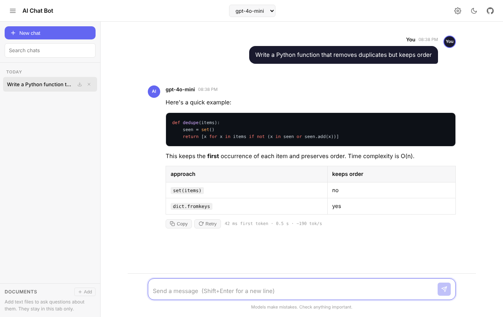
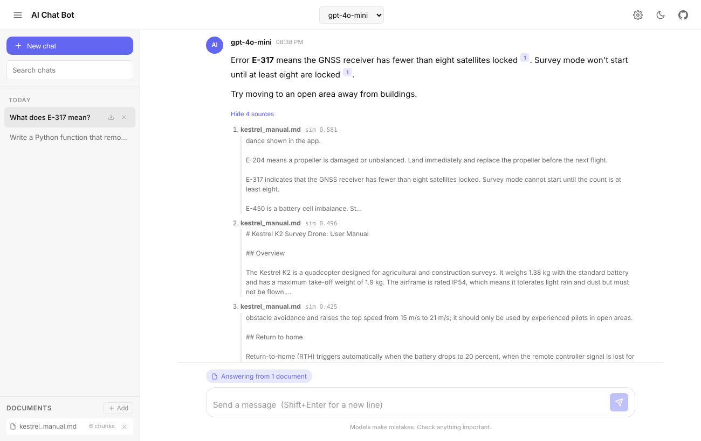

# AI Chat Bot

A streaming chat interface for LLMs that can also answer questions from your own documents, with citations.

It works with OpenAI or any OpenAI-compatible API (Groq, Together, OpenRouter, a local Ollama). Document retrieval is hybrid: dense embeddings plus BM25, merged with reciprocal rank fusion. The repo includes a small benchmark that compares the retrieval methods.



## Features

- Token-by-token streaming, with a stop button that also cancels the upstream request
- Edit any earlier message and resend it, or regenerate the last answer
- Markdown with syntax highlighting; the HTML is sanitized before rendering
- Conversations saved in localStorage, with search, rename and export to Markdown
- Settings for model, system prompt, temperature, max tokens and retrieval
- Per-reply latency stats: time to first token, total time and approximate tokens/sec
- **Document Q&A**: add `.txt` / `.md` / source files, ask questions, and get answers that cite numbered excerpts you can expand to check
- Works without an embeddings endpoint: if the provider doesn't have one, it falls back to BM25 keyword search
- The API key stays on the server. The browser only ever talks to `/api/*`



## Running it

You need Node 20 or newer.

```bash
git clone https://github.com/Aranya2801/AI-Chat-Bot.git
cd AI-Chat-Bot
npm install
cp .env.example .env      # put your key in LLM_API_KEY
npm run dev               # web on :3000, api on :8787
```

**Fully local with Ollama.** Install [Ollama](https://ollama.com), run `ollama pull llama3.1` and `ollama pull nomic-embed-text`, then set:

```env
LLM_BASE_URL=http://localhost:11434/v1
LLM_API_KEY=
EMBED_MODEL=nomic-embed-text
```

In the app, type `llama3.1` into the model field in settings.

**Production.** `npm run build && npm start` serves the built frontend and the API from a single Node process on port 8787. There's also a `Dockerfile`:

```bash
docker build -t ai-chat-bot .
docker run -p 8787:8787 --env-file .env ai-chat-bot
```

If you deploy it publicly, set `ALLOWED_MODELS`. Otherwise anyone who finds the URL can run your most expensive model on your key.

## How it works

```
Browser (React)                          server/index.js                  Provider
───────────────                          ───────────────                  ────────
InputBar ─► ChatContext.sendMessage
             │
             ├─ documents loaded?
             │    embed(question) ─────► POST /api/embeddings ──────────► /embeddings
             │    hybridRetrieve()        (key added here)
             │      cosine top-20  ┐
             │      BM25 top-20    ┴─► RRF ─► top k chunks
             │    buildContextPrompt()  → numbered excerpts [1]..[k]
             │
             └─ streamChat() ─────────► POST /api/chat ────────────────► /chat/completions
                  SSE parser ◄──────────── piped back as-is ◄──────────── (stream: true)
                  rAF-batched UI updates
```

The main files:

| File | What it does |
|---|---|
| `server/index.js` | Proxy with no dependencies. Validates and clamps parameters, adds the key, pipes the SSE stream, cancels upstream when the client disconnects, serves `dist/` in production |
| `src/lib/sse.js` | Incremental SSE parser that buffers partial lines |
| `src/lib/rag.js` | Chunking, cosine similarity, RRF and the context prompt |
| `src/lib/bm25.js` | BM25 index with a small tokenizer and stemmer |
| `src/context/chatReducer.js` | All chat state transitions (pure, unit tested) |
| `src/context/ChatContext.jsx` | Sending, streaming, stop/regenerate/edit, documents, persistence |

## Retrieval evaluation

`eval/` contains three short fictional documents (an HR handbook, a drone manual and a payments API reference) and 32 questions. Each question is labelled with the exact text that a correct retrieved chunk must contain. The documents are made up on purpose, so they can't be in any model's training data.

Questions come in two types:
- **keyword**: the question shares an exact token with the answer ("What does E-317 mean?")
- **paraphrase**: the question uses different words than the document ("Can I take my leftover holidays into next year?" vs. "no more than 8 days roll into the next year")

```bash
npm run eval:retrieval             # BM25 only, no API key needed
npm run eval:retrieval -- --dense  # adds embeddings and hybrid (uses .env, caches vectors)
```

BM25 results (chunk overlap 15%):

| chunk size | # chunks | R@1 | R@3 | R@5 | MRR@10 | R@5 keyword | R@5 paraphrase |
|---:|---:|---:|---:|---:|---:|---:|---:|
| 400 | 30 | 71.9 | 81.3 | 90.6 | 0.795 | 100.0 | 88.0 |
| 800 | 15 | 71.9 | 87.5 | 100.0 | 0.821 | 100.0 | 100.0 |
| 1200 | 9 | 75.0 | 100.0 | 100.0 | 0.859 | 100.0 | 100.0 |

What these numbers show:
- BM25 never misses keyword questions. All of its misses are paraphrases, where the question and the document share no words ("ill for more than two weeks" vs. "sick leave ... certificate"). This is the gap embeddings are meant to close. Run with `--dense` to measure how much they close it, and whether hybrid keeps BM25's perfect keyword score.
- Larger chunks look better here, but only partly because they are better. With 9 chunks in total, R@5 already covers more than half the corpus. A fair comparison of chunk sizes needs a much larger corpus. That's the obvious next step.
- R@1 stays around 72–75% at every chunk size. The right chunk is usually *somewhere* in the top 3, which is why the app sends k = 4 chunks by default rather than 1.

The `--dense` run writes its own table and saves full per-question results to `eval/results/`.

## Latency benchmark

```bash
npm run bench -- gpt-4o-mini gpt-4o
npm run bench -- --runs 10 llama3.1 qwen2.5    # with LLM_BASE_URL pointing at Ollama
```

The benchmark sends three fixed prompts per run at temperature 0, after one warm-up call. It reports median and p90 time to first token, plus median tokens/sec. The token count comes from the provider's `usage` field when available, otherwise chars/4. Raw data is saved as CSV in `eval/results/`.

## Tests

```bash
npm test
```

31 tests. They cover:
- the SSE parser, including a stream fed one character at a time
- chunking, BM25, RRF and the fallback paths
- the reducer, with regression tests for the v1 bugs listed below
- an integration test that starts a fake OpenAI server and checks the proxy: streaming, key handling, parameter clamping and error passthrough

CI runs lint, tests, build and the BM25 eval on every push.

## Bugs fixed from v1

The first version looked finished but didn't actually work. These are written down because each one taught me something:

1. **It didn't build.** All files were in the repo root, but the imports expected `src/components/...`.
2. **The API key was public.** `VITE_*` env variables are inlined into the JS bundle, so anyone could read the key in devtools. The fix was the server proxy.
3. **Missing words in replies.** The SSE parser split each network chunk on `\n`. When a JSON line was split across two reads, both halves failed to parse and were silently dropped. Now partial lines are buffered (see `tests/sse.test.js`).
4. **No syntax highlighting.** marked v5+ removed the `highlight` option. The old config ran without error and did nothing.
5. **XSS.** Model output went straight into `dangerouslySetInnerHTML`. Now it goes through DOMPurify first.
6. **Two chats per message.** Both `InputBar` and `submitMessage` created a conversation when none was active.
7. **Replies landing in the wrong chat.** Streaming updates were written to "the active conversation". If you switched chats mid-stream, the rest of the reply went into the other chat. Every action now carries an explicit `conversationId`.
8. **Deleting the active chat could re-select it.** The next chat was picked from the list before filtering.
9. **The README listed features that didn't exist**: saved history, settings, a demo GIF, a Vercel deployment. All of these are now real or removed.

## Limitations

- Uploaded documents live in memory and disappear when you refresh. Persisting the vectors (IndexedDB) is on the list.
- Only text-based files are supported. PDF parsing isn't added yet.
- Token counts in the UI are estimates (chars/4).
- The eval corpus is small (3 documents, 32 questions). It's good for catching regressions and showing the keyword vs. paraphrase split, but too small to conclude much about chunk size.
- There's no auth on the server. It's meant for personal or local use, or to run behind something that does auth.

## Ideas for next

- Store document vectors in IndexedDB so they survive a reload
- PDF support (pdf.js)
- Add a cross-encoder reranking step and measure it with the same eval
- A bigger eval set, plus answer-level evaluation (does the answer actually match the cited excerpt?)

## License

MIT
